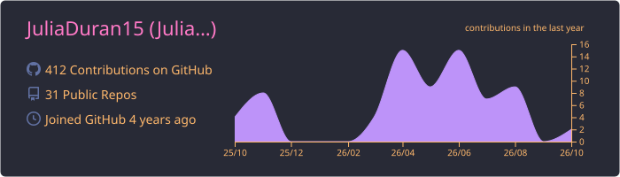
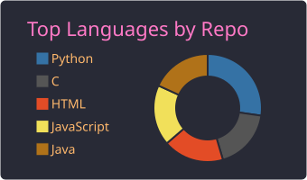
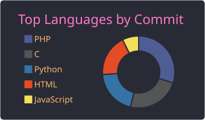
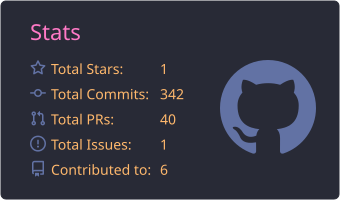
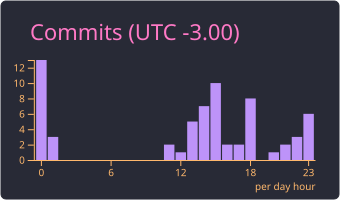

<h2 align="center">Olá, mundo! 👩‍💻</h2>

🎓 Formanda em <strong>Engenharia da Computação</strong> na <strong>PUC-Campinas</strong> (2022 – 2026)  
🏢 Estagiária de <strong>Implementação de Sistemas</strong> na <strong>Siemens</strong>, trabalhando com integração entre sistemas (SOAP, Web Services, XML e MDM)  
🔬 Iniciação Científica em <strong>Fotônica Integrada</strong>: gráficos interativos para análise de espectros e simulações aceleradas em GPU com <strong>CuPy</strong>  
💡 Gosto de desenvolvimento web, computação científica e de entender como os sistemas conversam entre si  
📍 Jundiaí, SP &nbsp; • &nbsp; 🌎 Inglês intermediário/avançado &nbsp; • &nbsp; <strong>Pronouns:</strong> she/her

---

### 🛠️ Habilidades Técnicas

#### 👩‍💻 Linguagens

#### 🧰 Frameworks & Bibliotecas

#### 🔗 Integração & Dados

#### ⚙️ Ferramentas

#### 📚 Metodologias
- Desenvolvimento Ágil (Scrum)
- Programação Orientada a Objetos (POO)

---

### 📈 GitHub Stats

<!-- Os cards abaixo são gerados pelo GitHub Action em .github/workflows/profile-summary-cards.yml
     e salvos no próprio repositório, então não dependem de servidores externos que caem. -->

  

  
  

  
  

---

### 📬 Contato

  
  
  

 

✨❀*:･ﾟ✧ Obrigada por visitar meu perfil! *:･ﾟ✧❀✨

